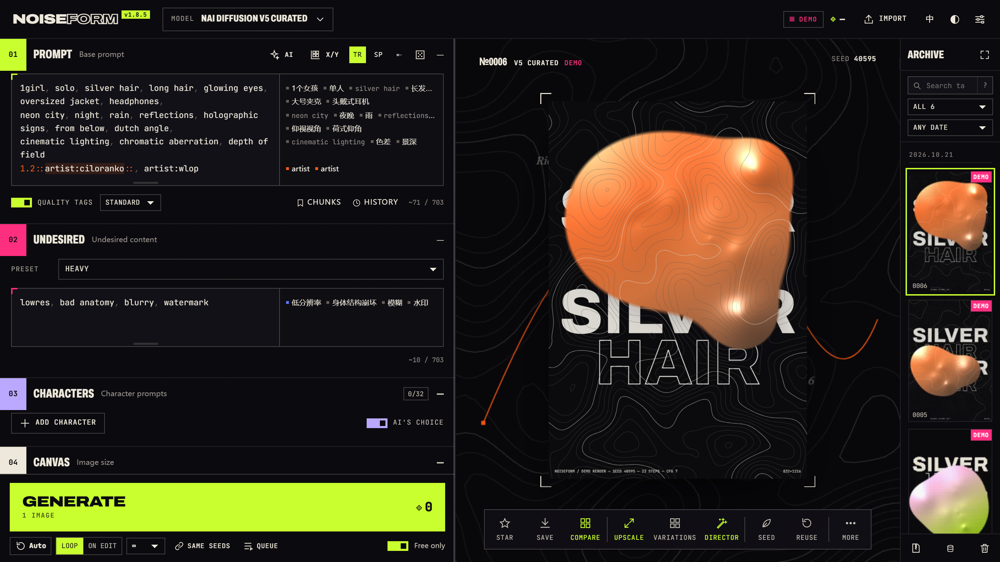

<div align="center">

<!-- HERO — wide product shot. Keep it about 2560×1440 so it stays sharp on high-DPI screens. -->


<pre>
███╗   ██╗ ██████╗ ██╗███████╗███████╗███████╗ ██████╗ ██████╗ ███╗   ███╗
████╗  ██║██╔═══██╗██║██╔════╝██╔════╝██╔════╝██╔═══██╗██╔══██╗████╗ ████║
██╔██╗ ██║██║   ██║██║███████╗█████╗  █████╗  ██║   ██║██████╔╝██╔████╔██║
██║╚██╗██║██║   ██║██║╚════██║██╔══╝  ██╔══╝  ██║   ██║██╔══██╗██║╚██╔╝██║
██║ ╚████║╚██████╔╝██║███████║███████╗██║     ╚██████╔╝██║  ██║██║ ╚═╝ ██║
╚═╝  ╚═══╝ ╚═════╝ ╚═╝╚══════╝╚══════╝╚═╝      ╚═════╝ ╚═╝  ╚═╝╚═╝     ╚═╝
</pre>

**An avant-garde studio for NovelAI image generation.**<br>
Batch without fear. Compare without guessing. Edit prompts with an AI that shows its work.

<sub>NOISE → FORM · 噪声成形</sub>

[](LICENSE)
[](https://nodejs.org)
[](#-03--run-it)
[](#-05--under-the-hood)

**English** · [简体中文](README.zh-CN.md)

</div>

---

## ▶ 00 · WATCH

<!--
  Video slot .mp4 (≤100 MB).
-->
<div align="center">

**🎬 Intro video — coming soon.**

</div>

---

## ◆ 01 · WHAT IT IS

NOISEFORM is a local web client for [NovelAI](https://novelai.net)'s image models (V5, V4.5, V4, V3). It covers what the official generator does, then adds:

- a batch queue that never touches the prompt you are editing
- X/Y grids that you set up by clicking tags in your prompt
- a searchable archive
- a GPU post-processing bench
- an AI prompt assistant whose suggestions you accept one at a time

It runs on your machine and keeps your images in your browser. Your token is sent only to NovelAI, or to the local proxy you run yourself.

> **No token? No problem.** Without a NovelAI token it runs in **DEMO** mode. Every feature works, the images are procedurally rendered posters, and nothing is charged.

---

## ◆ 02 · HIGHLIGHTS

<table>
<tr>
<td width="50%" valign="top">

### ⟢ Data Ocean
While an image generates, the stage fills with drifting data glyphs, including words from your own prompt. A reticle locks onto a frame and the camera zooms in as steps complete. The finished image develops inside that frame.

</td>
<td width="50%" valign="top">

### ⟢ A queue you can trust
Starting a batch freezes your parameters into a snapshot, so you can keep editing your draft. A diff strip offers *apply next*, *queue after* and *revert*. There are also same-seed batches, a queue history and single cut-in shots. If the network drops **after** a paid request was sent, the job pauses as **"result unknown"** instead of re-sending it, so you never pay twice for the same image.

</td>
</tr>
<tr>
<td valign="top">

### ⟢ X/Y grids on the prompt itself
Click a tag to make it a variable:
- on/off
- a weight sweep
- replacement values
- insertions

You can also add axes for steps, CFG, sampler and seed. Before you spend any Anlas, the grid previews each cell's prompt and cost.

</td>
<td valign="top">

### ⟢ AI assistant that shows its work
Works with any OpenAI-compatible model. Ask *"move it to the countryside"* or *"remove the man in the picture"*. It answers with **delete / replace / add** chips you tick one by one, including per-character edits and new positions. Every suggested tag is checked against a 110k-tag dictionary and NovelAI's own vocabulary. Vision models can also see the current image. An artist-pairing mode lets you refine artist tags over several rounds of feedback.

</td>
</tr>
<tr>
<td valign="top">

### ⟢ Prompt craft, bilingual
- syntax highlighting for <code>{}</code> <code>[]</code> <code>1.2::weights::</code>
- autocomplete in English **and Chinese** (type <code>红发</code>, get <code>red hair</code>)
- a review column with translations and spell-check
- <code>Ctrl+↑/↓</code> numeric weights
- <code>#</code> comments and collapsible sections
- reusable <code>@prompt-chunks</code>
- a prompt history you can restore from

</td>
<td valign="top">

### ⟢ An archive with a query language
Every image is kept locally in IndexedDB. Star with <code>F</code> or reject with <code>X</code>, compare 2–4 images side by side or A/B, import metadata from any NovelAI PNG, and search like this:<br><code>artist:wlop "long hair" -glasses model:v5 date:7d is:star</code>

</td>
</tr>
<tr>
<td valign="top">

### ⟢ Power tools that stay on the free tier
- **Character placement (V5):** drag numbered markers anywhere on the image.
- **Tiled upscale:** every tile stays under 1 MP, the size that can be generated free.
- **Post-processing bench:** WebGL2, 18 passes, live at full resolution, with presets and A/B compare.

</td>
<td valign="top">

### ⟢ Seven moods
Seven themes: INK (the default neon darkroom), **NOVELAI classic**, DUSK, MOSS, PAPER, MIST and LINEN.

</td>
</tr>
</table>

---

## ▶ 03 · RUN IT

```bash
git clone https://github.com/hiiii42/NoiseForm.git
cd NoiseForm
node server.js          # or: npm start
# → http://localhost:8787
```

That's all you need: **Node 22+**, no `npm install`, no build step. The server listens on `127.0.0.1` only.

**Go LIVE:** paste your NovelAI persistent API token into *Settings* (on novelai.net: Account Settings → Get Persistent API Token). It is stored in your browser's localStorage and sent only to NovelAI or to your own local proxy.

<details>
<summary><b>Can't reach NovelAI directly?</b></summary>

<br>

Switch *Settings → Connection* to **Local proxy**. `server.js` then forwards your requests, connecting directly by default. If you need to go through an HTTP proxy (for example your VPN client's local port), turn on *Settings → Upstream proxy* and enter its host and port (prefilled with `127.0.0.1:7890`). You can also set it when starting the server:

| Variable | Effect |
| --- | --- |
| `NF_UPSTREAM_PROXY=http://host:port` | Default upstream proxy when the setting is off. If unset, `HTTPS_PROXY` is used; otherwise direct. |
| `NAI_TOKEN=pst-…` | The proxy adds your token itself, so the browser needs none and still shows LIVE. |
| `NF_HOST` | Changes the listen address. The proxy still accepts **loopback only**. |
| `NF_LOG=0` | Turns off the proxy's per-request log lines. The in-memory diagnostics buffer is kept. |

</details>

<details>
<summary><b>Something stuck?</b></summary>

<br>

*Settings → Export diagnostics* downloads a JSON file covering the last ~200 requests, plus the local proxy's own log. For each request it records:
- the route
- time to headers and time to first frame
- how it ended: ok, http-error, unknown, timeout or aborted

It is **metadata only**: no tokens, prompts or images.

</details>

---

## ⌨ 04 · KEYS

| Key | Action | Key | Action |
| --- | --- | --- | --- |
| <kbd>Ctrl</kbd>+<kbd>Enter</kbd> | Generate (inserts a single shot if a batch is running) | <kbd>Ctrl</kbd>+<kbd>Shift</kbd>+<kbd>Enter</kbd> | Start / pause auto-generate |
| <kbd>S</kbd> | Lock / unlock this image's seed | <kbd>F</kbd> / <kbd>X</kbd> / <kbd>U</kbd> | Star / reject / clear |
| <kbd>←</kbd> <kbd>→</kbd> | Browse the filtered archive | <kbd>Ctrl</kbd>+<kbd>↑</kbd> <kbd>↓</kbd> | Tag weight ±0.1 |
| <kbd>Ctrl</kbd>+<kbd>/</kbd> | Comment / uncomment line | <kbd>Ctrl</kbd>+<kbd>←</kbd> <kbd>→</kbd> | Move tag left / right |
| <kbd>Alt</kbd>+click | Use only this image's seed | <kbd>Alt</kbd>+right-click | Apply its settings, keep your seed |

The full list is in the [user guide](docs/USER_GUIDE.md).

---

## ⚙ 05 · UNDER THE HOOD

- **Plain web platform.** Native ES modules, with no framework and no bundler. A small zero-dependency Node server serves the files and proxies the API.
- **Built for failure.**
  - Paid requests are never re-sent after a network error that leaves the outcome uncertain.
  - A watchdog ends requests that go silent.
  - An image that can't be stored waits in an *Unsaved* tray instead of being lost.
  - The queue survives page reloads and coordinates across browser tabs.
- **Tested.** About 175 unit tests and 47 headless-browser specs, all against mocks, so the suite never spends Anlas. Type checking is added gradually, using TypeScript over JSDoc.

```
server.js        static files + local-only NovelAI / LLM proxy
public/js/
  app/           generation, records, tools (no UI code; they talk to the UI through events)
  domain/        pure rules: cost, generation spec, prompt chunks
  queue/         repository · policy · runner · view
  aiplan.js      AI assistant: request → edit plan → patch (pure functions)
  ui/            stage, archive, panel, editor, workbench, dialogs …
```

More: [ARCHITECTURE.md](docs/ARCHITECTURE.md) · [CHANGELOG.md](CHANGELOG.md)

```bash
npm test                       # static checks + unit tests + headless Chrome specs
npm ci && npm run typecheck    # optional, dev only
```

---

## ⚠ 06 · FINE PRINT

- **Unofficial.** NOISEFORM is an independent project, not affiliated with or endorsed by Anlatan / NovelAI. "NovelAI" is their trademark. Generating images uses your own account and Anlas under [NovelAI's terms](https://novelai.net/terms).
- The API calls were reconstructed from the official web client. If NovelAI changes its API, the error messages will be the first sign.
- The tag dictionary, the fonts and the optional services NOISEFORM can call (nax.moe artist previews, MyMemory translation) each have their own terms. See [THIRD_PARTY.md](THIRD_PARTY.md).

## ◆ LICENSE

[GNU AGPL v3.0 only](LICENSE). If you run a modified version as a network service, you must offer its source code to the people who use it.

<div align="center">
<br>
<sub>made in the noise · 在噪声里成形</sub>
</div>
