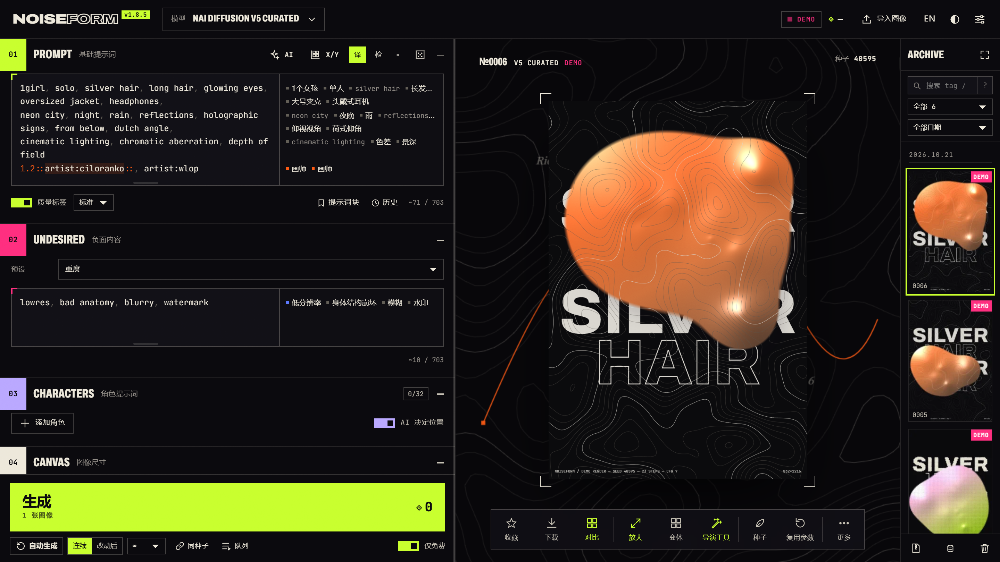

<div align="center">



<pre>
███╗   ██╗ ██████╗ ██╗███████╗███████╗███████╗ ██████╗ ██████╗ ███╗   ███╗
████╗  ██║██╔═══██╗██║██╔════╝██╔════╝██╔════╝██╔═══██╗██╔══██╗████╗ ████║
██╔██╗ ██║██║   ██║██║███████╗█████╗  █████╗  ██║   ██║██████╔╝██╔████╔██║
██║╚██╗██║██║   ██║██║╚════██║██╔══╝  ██╔══╝  ██║   ██║██╔══██╗██║╚██╔╝██║
██║ ╚████║╚██████╔╝██║███████║███████╗██║     ╚██████╔╝██║  ██║██║ ╚═╝ ██║
╚═╝  ╚═══╝ ╚═════╝ ╚═╝╚══════╝╚══════╝╚═╝      ╚═════╝ ╚═╝  ╚═╝╚═╝     ╚═╝
</pre>

**为 NovelAI 生图打造的前卫工作室。**<br>
放心跑批量，对比不靠猜，AI 改提示词时每一处改动都摆在你面前。

<sub>NOISE → FORM · 噪声成形</sub>

[](LICENSE)
[](https://nodejs.org)
[](#-03--跑起来)
[](#-05--技术底座)

[English](README.md) · **简体中文**

</div>

---

## ▶ 00 · 看一眼

[🎬 介绍视频](https://www.youtube.com/watch?v=7nn1Mbfcnrs)
<div align="center">

---

## ◆ 01 · 这是什么

NOISEFORM 是 [NovelAI](https://novelai.net) 图像模型（V5 / V4.5 / V4 / V3）的本地网页客户端。官方生成器能做的它都能做，另外还有：

- 不打扰编辑区的批量队列
- 直接在提示词上点出来的 X/Y 对比网格
- 能搜索的本地档案
- GPU 后处理工作台
- 逐条勾选修改的 AI 提示词助手

它跑在你自己的电脑上，图存在你自己的浏览器里，令牌只发给 NovelAI 或你本机的代理。

> **没有令牌也能玩。** 不填 NovelAI 令牌时是 **DEMO** 模式：所有功能都能用，出图是本地程序化渲染的海报，不花一点 Anlas。

---

## ◆ 02 · 亮点

<table>
<tr>
<td width="50%" valign="top">

### ⟢ 数据海洋
生成时，舞台会变成一片流动的数据点阵，里面夹着你提示词里的词。准星锁定一个画框，镜头随着步数推进不断放大，最终的图就在框里显影。

</td>
<td width="50%" valign="top">

### ⟢ 靠得住的队列
开始批量时，当前参数会冻结成一份快照，你可以接着改草稿。差异条提供三个选项：「下一张起应用」「跑完再排队」「还原」。此外还有同种子批量、队列历史和插队单张。付费请求已经发出后如果断网，任务会暂停并标为**「结果未知」**，不会自动重发，所以同一张图不会被扣两次费。

</td>
</tr>
<tr>
<td valign="top">

### ⟢ 在提示词上画 X/Y 网格
点一个 tag 就能把它设成变量：
- 有 / 无
- 权重扫描
- 替换成几个不同的值
- 在它前面插入

也可以加步数、CFG、采样器、种子作为参数轴。花 Anlas 之前，能先预览每一格实际用的提示词和费用。

</td>
<td valign="top">

### ⟢ AI 构思，改动一目了然
接入任意 OpenAI 兼容模型。说一句「换成农村场景」或「删掉图中的男人」，它会给出可以逐条勾选的 **删 / 换 / 加** 建议，也能按角色修改，包括调整站位。每个建议的 tag 都会对照 11 万词的本地词库和 NovelAI 自己的词表检查。支持识图的模型还能直接看当前生成的图。另有「搭画师」模式，根据你的反馈一轮轮调整画师组合。

</td>
</tr>
<tr>
<td valign="top">

### ⟢ 中英双语写提示词
- <code>{}</code> <code>[]</code> <code>1.2::权重::</code> 语法高亮
- 中英文都能补全（输入 <code>红发</code> 补出 <code>red hair</code>）
- 侧边审阅栏：逐行翻译和拼写检查
- <code>Ctrl+↑/↓</code> 直接改数值权重
- <code>#</code> 注释，可以折叠
- <code>@提示词块</code> 复用常用组合
- 提示词历史，随时恢复旧版本

</td>
<td valign="top">

### ⟢ 带查询语言的档案
所有图都存在本地 IndexedDB。用 <code>F</code> 收藏、<code>X</code> 淘汰；2–4 张图可以并排或 A/B 对比；能导入任何 NovelAI PNG 里的元数据；还能这样搜索：<br><code>artist:wlop "long hair" -glasses model:v5 date:7d is:star</code>

</td>
</tr>
<tr>
<td valign="top">

### ⟢ 吃满免费额度的工具
- V5 自由站位：在图上直接拖动编号圆点来摆角色。
- 分块放大：每一块都控制在可以免费生成的 1MP 以内。
- WebGL2 后处理工作台：18 个处理通道，在原分辨率下实时预览，支持预设和 A/B 对比。

</td>
<td valign="top">

### ⟢ 七种气质
七套配色：INK 霓虹暗房、**NOVELAI 经典**、DUSK、MOSS、PAPER、MIST、LINEN。

</td>
</tr>
</table>

---

## ▶ 03 · 跑起来

```bash
git clone https://github.com/hiiii42/NoiseForm.git
cd NoiseForm
node server.js          # 或 npm start
# → http://localhost:8787
```

只需要 **Node 22+**，不用 `npm install`，也不用构建。服务只监听 `127.0.0.1`。

**切换到 LIVE：** 在「设置」里粘贴 NovelAI 持久 API 令牌（获取方式：novelai.net → Account Settings → Get Persistent API Token）。令牌只保存在本机浏览器的 localStorage 里，只会发送给 NovelAI 或你本机的代理。

<details>
<summary><b>连不上 NovelAI？</b></summary>

<br>

在「设置 → 连接」里切到**本地代理**，由 `server.js` 帮你转发请求，默认直连。需要经过 HTTP 代理（比如代理软件的本地端口）时，打开「设置 → 上游代理」，填地址和端口（默认 `127.0.0.1:7890`）。也可以在启动时用环境变量设置：

| 环境变量 | 作用 |
| --- | --- |
| `NF_UPSTREAM_PROXY=http://host:port` | 设置里没开上游代理时的默认代理；不设则看 `HTTPS_PROXY`，都没有就直连 |
| `NAI_TOKEN=pst-…` | 由代理自动带上令牌，浏览器里不填令牌也能显示 LIVE |
| `NF_HOST` | 修改监听地址；代理仍然**只接受本机请求** |
| `NF_LOG=0` | 关掉代理每个请求的日志行（内存里的诊断记录照常保留） |

</details>

<details>
<summary><b>卡住了？</b></summary>

<br>

在「设置 → 导出诊断日志」可以下载一个 JSON 文件，里面有最近约 200 个请求的记录和本地代理自己的日志。每个请求记录这几项：
- 走的线路
- 多久收到响应头、多久收到第一帧
- 怎么结束的：成功、HTTP 错误、结果未知、超时、取消

**只记录这类元数据**，不含令牌、提示词和图片。

</details>

---

## ⌨ 04 · 快捷键

| 键 | 作用 | 键 | 作用 |
| --- | --- | --- | --- |
| <kbd>Ctrl</kbd>+<kbd>Enter</kbd> | 生成（批量运行中则插队一张） | <kbd>Ctrl</kbd>+<kbd>Shift</kbd>+<kbd>Enter</kbd> | 开始 / 暂停自动生成 |
| <kbd>S</kbd> | 锁定 / 解锁当前图的种子 | <kbd>F</kbd> / <kbd>X</kbd> / <kbd>U</kbd> | 收藏 / 淘汰 / 清除标记 |
| <kbd>←</kbd> <kbd>→</kbd> | 按筛选结果翻看档案 | <kbd>Ctrl</kbd>+<kbd>↑</kbd> <kbd>↓</kbd> | tag 权重 ±0.1 |
| <kbd>Ctrl</kbd>+<kbd>/</kbd> | 注释 / 取消注释当前行 | <kbd>Ctrl</kbd>+<kbd>←</kbd> <kbd>→</kbd> | tag 左移 / 右移 |
| <kbd>Alt</kbd>+左键 | 只用这张图的种子 | <kbd>Alt</kbd>+右键 | 套用这张图的参数，保留当前种子 |

完整列表见[使用指南](docs/USER_GUIDE.md)。

---

## ⚙ 05 · 技术底座

- **纯 Web 平台。** 原生 ES modules，不用框架，不用打包工具。一个零依赖的小型 Node 服务负责提供文件和代理 API。
- **为出错而设计。** 付费请求遇到「不确定是否已执行」的网络错误时，绝不自动重发。请求长时间没有响应会被看门狗结束。图片入库失败时会留在「待保存」里，不会丢。队列在刷新页面后还在，多个标签页之间也会互相协调，不会重复运行。
- **有测试兜底。** 约 175 个单元测试和 47 个无头浏览器测试，全部使用模拟接口，跑测试不花 Anlas。类型检查用 TypeScript 读取 JSDoc 注解，逐步扩大覆盖范围。

```
server.js        静态文件 + 只对本机开放的 NovelAI / LLM 代理
public/js/
  app/           生成、档案、工具：不依赖界面代码，通过事件和界面通信
  domain/        纯规则：费用、生成规格、提示词块
  queue/         repository · policy · runner · view
  aiplan.js      AI 构思：请求 → 编辑计划 → 写回（纯函数）
  ui/            舞台、档案、面板、编辑器、工作台、对话框……
```

深入了解：[架构说明](docs/ARCHITECTURE.md) · 更新记录：[CHANGELOG](CHANGELOG.md)

```bash
npm test                       # 静态检查 + 单元测试 + 无头 Chrome 测试
npm ci && npm run typecheck    # 可选，仅开发时使用
```

---

## ⚠ 06 · 免责说明

- **非官方。** NOISEFORM 是独立项目，与 Anlatan / NovelAI 没有关联，也没有得到它们的认可；"NovelAI" 是其商标。生成图片会使用你自己的账号和 Anlas，并受 [NovelAI 服务条款](https://novelai.net/terms) 约束。
- 接口调用方式是参照官方网页客户端整理的。如果 NovelAI 改了接口，最先出现的会是报错信息。
- 标签词库、字体，以及可选接入的外部服务（nax.moe 画师预览、MyMemory 翻译）各有各的条款，详见 [THIRD_PARTY.md](THIRD_PARTY.md)。

## ◆ 许可

[GNU AGPL v3.0（仅此版本）](LICENSE)。如果你把修改后的版本作为网络服务提供给别人使用，需要向这些用户提供对应的源代码。

<div align="center">
<br>
<sub>made in the noise · 在噪声里成形</sub>
</div>
